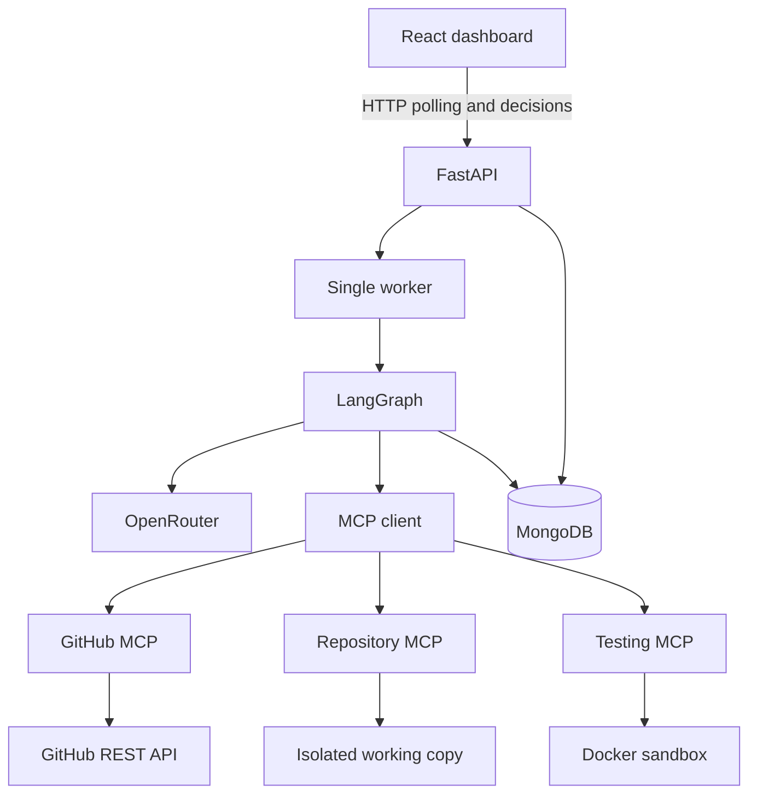

# Architecture

DevPilot is one local FastAPI application plus a React SPA and three short-lived MCP subprocesses. Four agents are roles within one LangGraph, not four deployed services.

## Request lifecycle

POST /api/tasks authenticates the local dashboard token, validates the configured repository, inserts a task and queues a worker. The worker copies safe files from a committed Git revision, never from uncommitted working-tree content. The graph loads an issue, plans, investigates bounded source context, proposes and validates a patch, tests it in Docker, then reviews it. It pauses for human approval. The UI polls persisted projections and events rather than holding an HTTP request open.

GitHub writes use Git Database API tree/commit/ref operations, followed by draft PR creation. There is no host git push carrying a credential. All agent-facing GitHub/repository/testing interactions go through MCP.

## Persistence

| Collection/state | Purpose |
|---|---|
| tasks | UUID primary key, request, current status, status_history, workflow projection, approval hash and atomic decision claim |
| workflow_events | Agent/tool starts, completion, pause/failure, retry attempt, timestamp; no raw prompts or credentials |
| workflow_checkpoints | Official MongoDBSaver graph checkpoints |
| workflow_checkpoint_writes | Checkpointer pending writes |
| workflow_decisions | Backend-generated receipt, payload hash, human decision, timestamp |
| workflow_workspaces | Workspace path-to-task binding |
| Local approval JSON | Exact GitHub write plan, expiry and one-use consumption |

Checkpoint state contains relevant source, issue text, patches and test output. This is necessary for recovery and can contain private repository content. Use a private database and restrict access; there is no automatic retention policy. Events omit these payloads.

PyMongo routes execute in FastAPI's thread pool; a separate one-thread executor runs the graph. Listing uses bounded offset pagination, not a transactional snapshot. No distributed queue exists. MongoDB _id indexes provide task lookup; event/list scans are acceptable for this small MVP and would need additional indexes at scale.

## Directory map

- frontend/src: routed dashboard, fetch contract, diff rendering, dark responsive styles.
- backend/app/api: task, approval and health routes.
- backend/app/services: OpenRouter, MCP client, local approval store, worker.
- backend/app/workflow: typed state/output models, graph, MongoDB runtime.
- backend/app/mcp_tools: adapters, safe workspace/patch implementation and Docker/GitHub tools.
- backend/scripts: connectivity, workspace preparation, recovery, evaluation.
- backend/tests: unit, API, graph, protocol and opt-in external integration tests.
- sandbox: fixed runner and Dockerfile.
- demo-repo: two original intentional bugs.
- benchmarks: five independent issue fixtures and reference solutions.
- docs: architecture, setup, decisions, audit, evaluation, test evidence and interview preparation.
