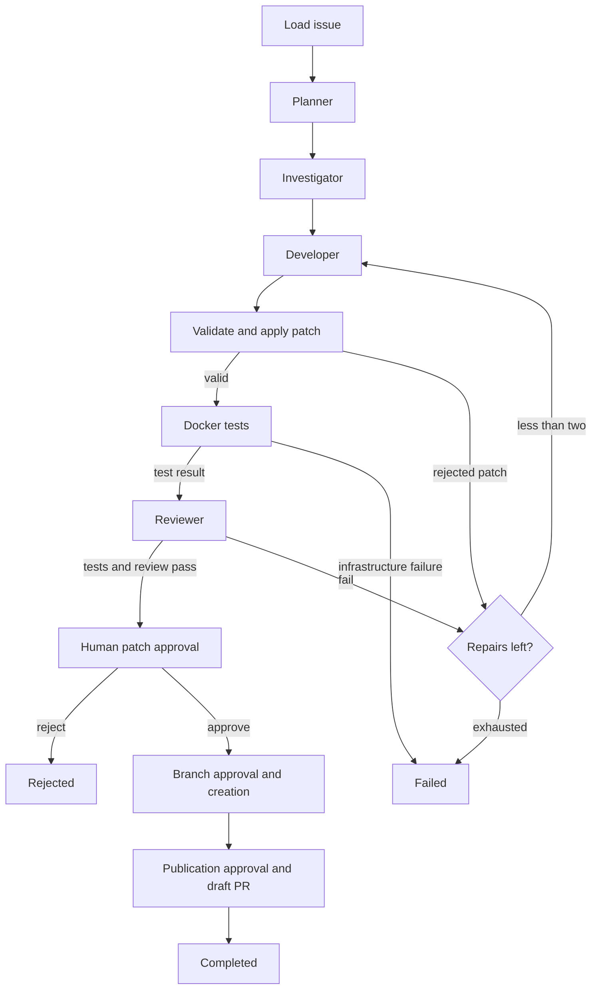

# LangGraph workflow



All nodes also terminate on unrecoverable service errors. Reviewer approval never overrides a nonzero exit code or failed test status. Initial development plus at most two repair attempts means at most three candidate patches. Invalid patches receive deterministic feedback; infrastructure errors stop immediately instead of consuming repair attempts.

Planner produces steps and likely areas. Investigator first selects files/search terms, then summarizes bounded retrieved context (at most four files and 20,000 characters). Developer produces a unified patch and explanation; the explanation is persisted as change_summary. Reviewer receives issue, actual diff and test output and produces a verdict plus feedback. All outputs are Pydantic validated.

State includes task_id, repository, issue_number, issue_details, plan, relevant_files, investigation_summary, patch, changed_files, test_results, review_feedback, retry_count, approval_status, current_step, task_status, pr_url and error; auxiliary fields include branch/base, diff, patch_valid, review_passed and change_summary.

## Durable human decisions

A stable `task:<UUID>` thread ID identifies a graph. `interrupt(payload)` saves progress through MongoDBSaver. `Command(resume=receipt)` resumes the same thread. The receipt is created by trusted backend logic after an authenticated decision and is looked up by task and exact payload hash. Model output cannot mint a valid receipt.

There are three approvals: patch, branch request, and publication request. The latter two are needed because the exact GitHub write plan is available only when its tool prepares it. The dashboard shows each request. Duplicate or stale decisions receive HTTP 409 via an atomic MongoDB update.

LangGraph restarts an interrupted node from the beginning. Preparing an approval request is safe to repeat; actual writes consume an exact authorization once. A crash during publication is deliberately fail-closed, not exactly-once delivery. Inspect the GitHub branch/commit/PR before recovery; no automatic write replay is allowed.

## Restart procedure

Stop the API before using the CLI so two runners cannot resume the same task. Preserve MongoDB and the local MCP_STATE_DIR. Run from backend:

```powershell
..\.venv\Scripts\python -m scripts.run_workflow TASK_UUID
```

The runtime resolves an existing task's workspace binding if MCP_WORKSPACE is empty, restores the UI projection from its checkpoint, and stops at pending approvals. Use `--decide` only from an interactive terminal after reviewing the displayed request. Start the API again and refresh the task. A clean restart at a human pause is supported. The in-memory queue does not automatically recover queued tasks; a hard crash may leave a local lock. Remove a stale lock only after confirming there is no live worker and inspecting the task/publication state. Recovery during arbitrary partially executed mutations is not guaranteed.

Automated tests reconstruct the graph with an in-memory saver. A separate opt-in test uses real MongoDB with two Python processes; its result is separately reported. Neither should be confused with a verified live GitHub publication.

References: https://docs.langchain.com/oss/python/langgraph/interrupts and https://reference.langchain.com/python/langgraph/types/interrupt .
